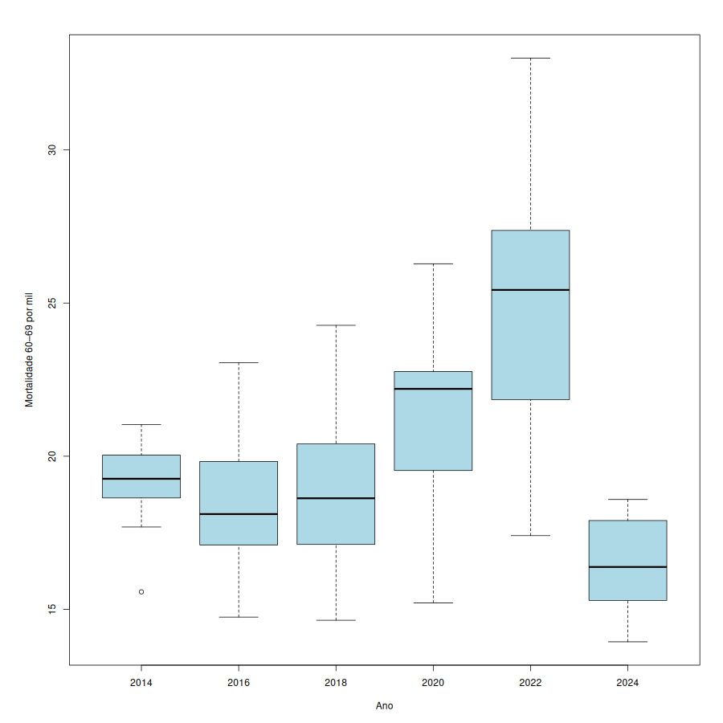
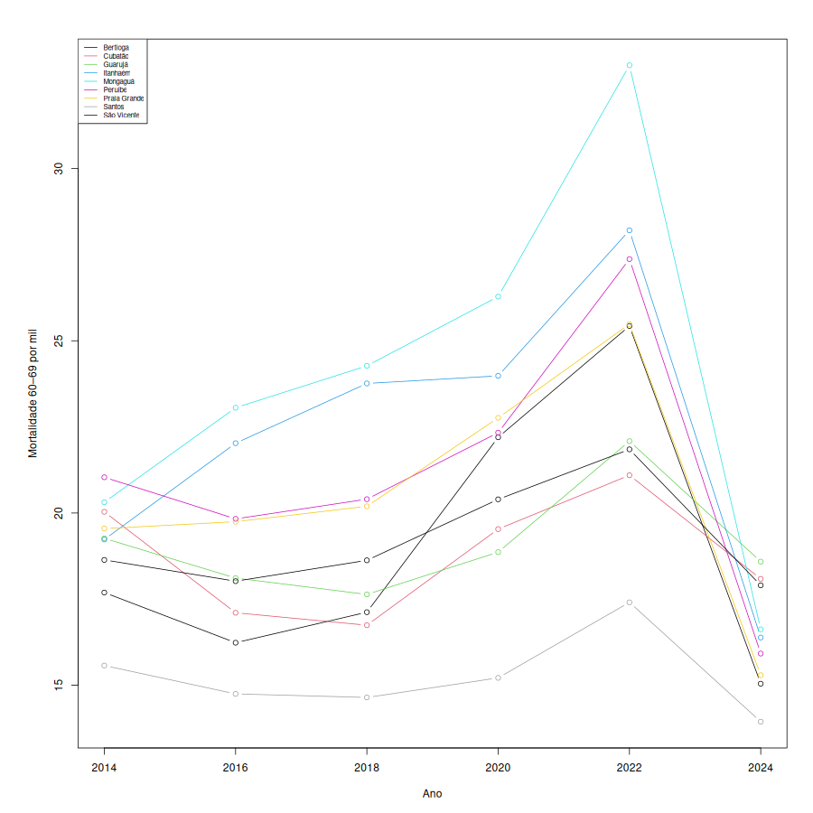
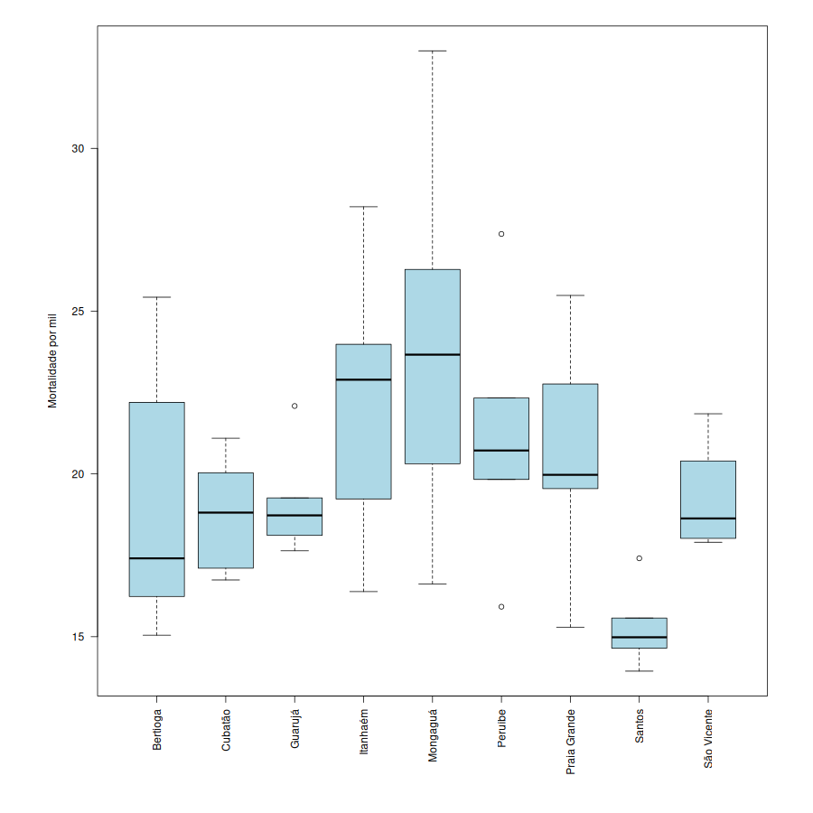

# Atividade 02b — Análise Exploratória Segmentada: Onde (Município) e Quando (Ano)

> **Este documento é o resultado do script**  
> [`estrutura/codigos/02b-analise-exploratoria-segmentada.R`](../estrutura/codigos/02b-analise-exploratoria-segmentada.R) (auditoria numérica em [`02b-numeros.txt`](../estrutura/codigos/02b-numeros.txt); análise exploratória global em [`02a-analise-exploratoria-ampla.md`](02a-analise-exploratoria-ampla.md)).

> **Alvo ($Y$):** `mortalidade_60_69` (taxa de mortalidade de 60 a 69 anos, por mil habitantes).  
> **Estrutura de painel:** 9 municípios da Região Metropolitana da Baixada Santista $\times$ 6 edições bienais (2014–2024), totalizando $n = 54$ observações perfeitamente balanceadas.

---

## 1. Por que Segmentar o Painel por Município e por Ano?

Na [Atividade 02a](02a-analise-exploratoria-ampla.md), vimos que as correlações lineares brutas entre os indicadores socioeconômicos contínuos (`escolaridade`, `distorcao_em`, `pib_per_capita`) e a mortalidade de 60 a 69 anos são fracas quando misturamos todas as 54 linhas como se fossem independentes.

Contudo, nosso banco é um **painel longitudinal**: cada linha é um par $(\mathrm{municipio}_i, \mathrm{ano}_t)$. Desagregar as médias marginais nos dois eixos estruturais do painel revela imediatamente onde mora a variação real dos dados — preparando o terreno para a **Pergunta 1 da Entrega 1** ($y_{it} = \mu + \alpha_i + \gamma_t + \varepsilon_{it}$).

---

## 2. Segmentação Espacial: Médias por Município (2014–2024)

| `municipio` | `riqueza` | `escolaridade` | `distorcao_em` | `mortalidade_60_69` | Perfil Territorial na Baixada Santista |
| --- | --- | --- | --- | --- | --- |
| **Bertioga** | 0.5510 | 0.4773 | 15.2320 | 18.9534 | Alta riqueza municipal; mortalidade abaixo da média regional |
| **Cubatão** | 0.5065 | 0.4850 | 19.8848 | 18.7669 | Polo industrial; maior distorção escolar média (19,88%) |
| **Guarujá** | 0.4327 | 0.4490 | 15.8133 | 19.0921 | Patamar intermediário de mortalidade e indicadores sociais |
| **Itanhaém** | 0.3938 | 0.5325 | 15.5447 | **22.2655** | **2ª maior mortalidade média** (Litoral Sul) |
| **Mongaguá** | 0.3573 | 0.4508 | 17.3061 | **23.9239** | **Maior vulnerabilidade estrutural** (+8,67 óbitos/mil acima de Santos) |
| **Peruíbe** | 0.3822 | 0.4652 | 14.7247 | 21.1491 | Terceiro maior patamar de mortalidade (Litoral Sul) |
| **Praia Grande** | 0.4097 | 0.5528 | 17.1115 | 20.5053 | Maior escolaridade média no período; mortalidade levemente acima da média |
| **Santos** | 0.5010 | 0.5420 | 12.7966 | **15.2555** | **Menor mortalidade estrutural** e menor distorção escolar (12,80%) |
| **São Vicente** | 0.3583 | 0.4293 | 18.9476 | 19.2389 | Menor escolaridade e segunda maior distorção; mortalidade na média |

**Leitura analítica:** Há um abismo persistente de **$8{,}67$ mortes por mil habitantes** entre a média histórica de **Mongaguá** ($23{,}92$) e a de **Santos** ($15{,}26$). Todo o eixo do Litoral Sul (Mongaguá, Itanhaém e Peruíbe) opera estruturalmente acima de $21$ mortes/mil hab., enquanto o núcleo central com rede hospitalar de alta complexidade (Santos) opera próximo de $15$ mortes/mil hab.

---

## 3. Segmentação Temporal: Médias por Edição Bienal (2014–2024)

| `ano` | `riqueza` | `escolaridade` | `distorcao_em` | `mortalidade_60_69` | Contexto Epidemiológico e Demográfico |
| --- | --- | --- | --- | --- | --- |
| **2014** | 0.4491 | 0.4066 | 18.8481 | 19.0369 | Patamar basal pré-pandemia |
| **2016** | 0.4286 | 0.4719 | 17.9972 | 18.7649 | Estabilidade pré-pandemia |
| **2018** | 0.4414 | 0.5104 | 18.3140 | 19.2675 | Estabilidade pré-pandemia |
| **2020** | 0.4340 | 0.5338 | 16.0382 | **21.2854** | **Início do choque pandêmico (COVID-19)** |
| **2022** | 0.4266 | 0.4893 | 14.8100 | **24.6582** | **Pico agudo da série histórica (+5,6 mortes/mil vs. 2014–2018)** |
| **2024** | 0.4153 | 0.5107 | 12.2333 | **16.4208** | **Forte retração pós-vacinação / colheita demográfica** |

**Leitura analítica:** Entre 2014 e 2018, a média regional da Baixada Santista permaneceu estacionada em torno de $19{,}0$ mortes por mil habitantes. Em **2020** ($21{,}29$) e sobretudo em **2022** ($24{,}66$), o choque da pandemia de COVID-19 deslocou toda a distribuição regional para cima, seguido de queda acentuada em **2024** ($16{,}42$). Como essa trajetória sobe e depois cai bruscamente, tratar `ano` como uma reta linear simples ($\beta \cdot \mathrm{ano}$) apaga o sinal temporal — exigindo efeitos fixos por ano (`factor(ano)`) ou suavizadores não-paramétricos (`s(ano)`).

---

## 4. Análise das Figuras Segmentadas

### Figura 1 — Distribuição da Mortalidade por Ano (Choque Pandêmico)

- O boxplot temporal mostra claramente a onda não-linear: estabilidade entre 2014 e 2018, salto expressivo da mediana e do topo em 2020–2022 (chegando a $33{,}00$ em Mongaguá/2022) e retorno ao menor nível da década em 2024.

### Figura 2 — Trajetórias Municipais ao Longo do Tempo (Spaghetti Plot)

- As curvas dos 9 municípios sobem quase em paralelo em 2020–2022 e recuam juntas em 2024, mantendo sua hierarquia relativa (Santos sempre na base do gráfico; Mongaguá e Itanhaém sempre no topo). Essa estrutura de **curvas paralelas deslocadas verticalmente** é a assinatura visual clássica de um modelo aditivo de efeitos fixos ($\mathrm{municipio} + \mathrm{ano}$).

### Figura 3 — Heterogeneidade Estrutural entre Municípios

- Comparando as caixas municipais, confirma-se que a variação *entre* municípios é dominante frente à variação residual: a caixa inteira de Santos fica abaixo das medianas de todos os demais municípios da Baixada Santista.

---

## 5. Implicações Metodológicas para a Modelagem

1. **Dependência longitudinal:** As 54 linhas repetem os mesmos 9 municípios em 6 edições e não são realizações independentes. As tabelas acima descrevem médias condicionais observadas, sem interpretação causal direta.
2. **Interpolação vs. extrapolação temporal:** A validação cruzada aleatória no painel avalia a capacidade de reconstruir células município-ano dentro do horizonte 2014–2024, mas deve ser distinguida da previsão de edições futuras (que exigiria validação temporal *forward-chaining*).

---

## Documentos Complementares

- 🧮 **Script gerador:** [`02b-analise-exploratoria-segmentada.R`](../estrutura/codigos/02b-analise-exploratoria-segmentada.R)
- 📋 **Auditoria numérica:** [`02b-numeros.txt`](../estrutura/codigos/02b-numeros.txt)
- 📎 **Análise exploratória ampla:** [`02a-analise-exploratoria-ampla.md`](02a-analise-exploratoria-ampla.md)
