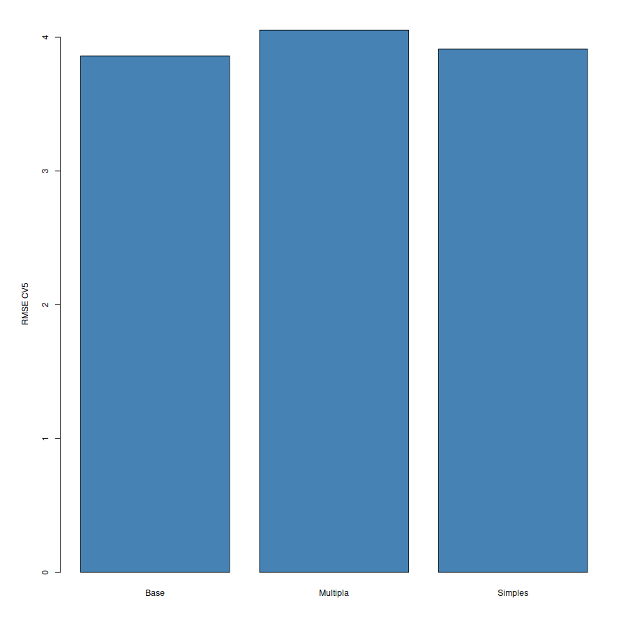
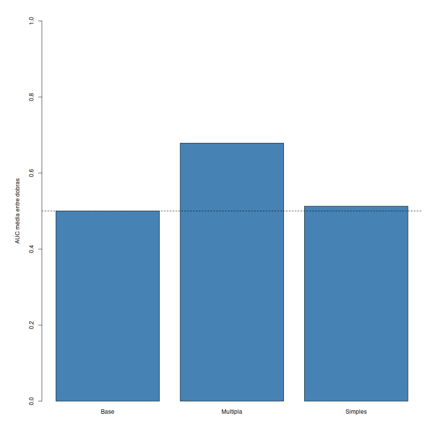
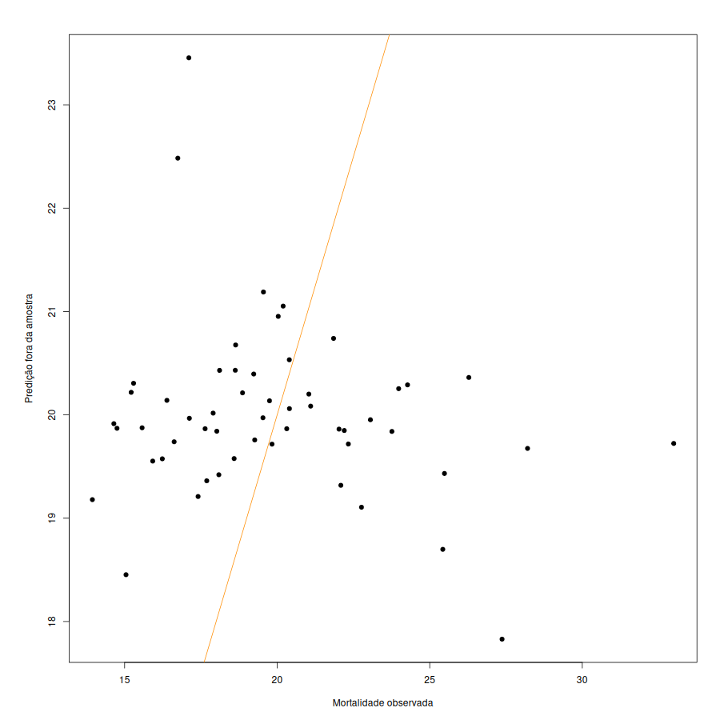

# Atividade 05 — Avaliação e Seleção de Modelos: Treino, Teste e Compromisso Viés–Variância (Aula 06)

> **Este documento é o resultado do script**  
> [`estrutura/codigos/05-avaliacao-selecao-modelos.R`](../estrutura/codigos/05-avaliacao-selecao-modelos.R) (auditoria numérica em [`05-numeros.txt`](../estrutura/codigos/05-numeros.txt); predições por observação em [`05-predicoes.csv`](../estrutura/codigos/05-predicoes.csv); resumo em [`05-resultados.csv`](../estrutura/codigos/05-resultados.csv)).

> **Alvo contínuo (Regressão):** `mortalidade_60_69` (mortes por mil hab., 60–69 anos).  
> **Alvo binário (Classificação):** `classe` $= \mathbb{I}(y_i > \mathrm{mediana}_{\mathrm{treino}})$, onde o corte é aprendido **exclusivamente dentro do conjunto de treino** de cada partição.  
> **Candidatos avaliados:** `Base` (média/proporção do treino), `Simples` (`escolaridade`) e `Multipla` (`escolaridade + distorcao_em`).

---

## 1. O Problema: A Arte de Não Enganar a Si Mesmo

Nas Atividades [03](03-regressao-linear.md) e [04](04-regressao-logistica.md), ajustamos modelos nas **54 observações inteiras** e medimos o desempenho nas mesmas 54 observações. Em Aprendizado Estatístico, avaliar um modelo nos mesmos dados usados para treiná-lo configura **autoengano** (*in-sample optimism*): é como aplicar numa prova exatamente as questões cujo gabarito o aluno decorou na véspera.

Nesta atividade unificada da **Aula 06**, regressão e classificação compartilham a mesma leitura de dados, a mesma divisão treino/teste ($70\% / 30\%$, $n_{\mathrm{tr}} = 37$, $n_{\mathrm{te}} = 17$, `seed = 1`) e exatamente as mesmas 5 dobras de validação cruzada externa (`CV5 externa`, `seed = 1`).

---

## 2. Resultados Unificados: Divisão 70/30 e Validação Cruzada (5 Dobras)

| Avaliacao | Modelo | RMSE | MAE | Acuracia | Brier |
| --- | --- | --- | --- | --- | --- |
| Teste 30% | Base | **3.6782** | **2.9734** | 0.5294 | **0.2494** |
| Teste 30% | Multipla | 3.7887 | 3.0999 | 0.5294 | 0.2525 |
| Teste 30% | Simples | 3.8314 | 3.1914 | 0.2353 | 0.2637 |
| CV5 externa | Base | **3.8599** | **2.9855** | 0.5000 | **0.2510** |
| CV5 externa | Multipla | 4.0522 | 3.1450 | **0.5926** | 0.2562 |
| CV5 externa | Simples | 3.9117 | 3.0180 | 0.4815 | 0.2523 |

*(Nota técnica sobre a agregação da CV5: na tabela acima, o RMSE de `CV5 externa` é calculado agrupando os 54 erros fora da amostra, $\sqrt{\frac{1}{n}\sum_{i=1}^{54}(y_i - \hat{y}_i^{(-k(i))})^2} = 3{,}8599$ para a Base; quando calculado pela média das 5 dobras de tamanhos $11, 11, 11, 11, 10$, vale $3{,}8425$, como reportado na Entrega 1. Em ambas as convenções o ordenamento dos modelos é idêntico).*

### AUC Média das Cinco Dobras (Classificação)

| Modelo | AUC | Leitura Discriminativa |
| --- | --- | --- |
| **Base** | 0.5000 | Acaso puro (referência teórica) |
| **Multipla** (`escolaridade + distorcao_em`) | **0.6786** | **Sinal discriminativo real** (vence em 4 das 5 dobras) |
| **Simples** (`escolaridade`) | 0.5129 | Indistinguível de jogar uma moeda |

---

## 3. Leitura Analítica dos Resultados

### 3.1. Regressão: Quando a Linha de Base Vence os Preditores Educacionais
- **Na divisão 70/30 (`Teste 30%`):** A linha de base (prever sempre a média do treino) atinge $\mathrm{RMSE} = \mathbf{3{,}6782}$ (MAE $= 2{,}9734$), superando tanto o modelo `Simples` ($\mathrm{RMSE} = 3{,}8314$, $R^2_{\mathrm{teste}} = -0{,}1187$) quanto o modelo `Multipla` ($\mathrm{RMSE} = 3{,}7887$, $R^2_{\mathrm{teste}} = -0{,}0939$). Um $R^2$ de teste negativo indica formalmente que os preditores educacionais isolados erram mais do que chutar a média regional.
- **Na validação cruzada (`CV5 externa`):** O veredito se confirma com maior estabilidade: a `Base` vence ($\mathrm{RMSE} = \mathbf{3{,}8599}$), seguida da `Simples` ($3{,}9117$) e da `Multipla` ($4{,}0522$).

### 3.2. Classificação e a Prevenção de Vazamento na Mediana
- **A sutileza da mediana do treino:** Para definir a classe `alta` ($0/1$) sem vazamento de dados (*data leakage*), o limiar é calculado exclusivamente com as observações de treino de cada partição:
  $$m^{(-j)} = \mathrm{mediana}\left(\lbrace y_i : i \in D_{\mathrm{treino}}^{(-j)} \rbrace\right), \qquad \mathrm{Classe}_i = \mathbb{I}\left(y_i > m^{(-j)}\right)$$
  Como cada dobra de treino possui um corte $m^{(-j)}$ ligeiramente distinto, as probabilidades preditas de dobras diferentes referem-se a limiares diferentes; por isso, a **AUC é calculada dentro de cada dobra e depois promediada**.
- **O colapso do modelo Simples no Teste 30% vs. recuperação na CV5:** No split único 70/30, o modelo `Simples` colapsa para acurácia de $23{,}53\%$ (nenhuma probabilidade predita no teste superou $0{,}5$, gerando sensibilidade zero e $\mathrm{AUC} = 0{,}2639$). Na `CV5 externa`, a variância da partição única é diluída: o modelo `Simples` volta para perto de $50\%$ ($\mathrm{Acc} = 48{,}15\%$, $\mathrm{AUC} = 0{,}5129$), enquanto o modelo `Multipla` (`escolaridade + distorcao_em`) salta para **$\mathrm{Acc} = 59{,}26\%$** e **$\mathrm{AUC} = 0{,}6786$**, mostrando que a distorção idade-série agrega informação útil para separar os municípios mais vulneráveis.

---

## 4. Análise das Figuras

### Figura 1 — Comparação de RMSE em Validação Cruzada (Regressão)

- A barra da `Base` é a menor das três: sem controlar pelo município e pelo ano, adicionar preditores educacionais lineares só acrescenta variância de estimação.

### Figura 2 — Comparação de AUC Média entre Dobras (Classificação)

- A linha tracejada horizontal marca o chute aleatório ($\mathrm{AUC} = 0{,}50$). Enquanto a regressão logística `Simples` mal descola da linha tracejada ($0{,}5129$), a `Multipla` atinge $0{,}6786$.

### Figura 3 — Predição Fora da Amostra vs. Mortalidade Observada

- Os pontos concentram-se numa faixa horizontal estreita (entre $18$ e $22$ mortes/mil hab.), longe da reta identidade laranja ($y = x$). Isso ilustra visualmente o **alto viés** do modelo socioeconômico puro: sem saber *qual é o município* e *qual é o ano*, o modelo encolhe suas previsões para perto da média global.

---

## 5. Fundamentação Matemática e Resolução dos Exercícios (Aula 06)

Para consolidar o rigor teórico da **Aula 06** ([`slides_aulas/TAE_aula06.PDF`](../slides_aulas/TAE_aula06.PDF) — *Treino, teste e o compromisso viés–variância*), apresentamos a formulação matricial polinomial, a decomposição do erro esperado de teste e as soluções dos exercícios dos slides 19–20/23.

### 5.1. Formulação Matricial Polinomial e Decomposição Viés–Variância

Um polinômio de grau $d$ sobre um preditor escalar $x$ é linear nos parâmetros $\beta = (\beta_0, \beta_1, \dots, \beta_d)^\top$ e escreve-se na forma matricial $\mathbf{y} = \mathbf{X}\beta + \varepsilon$:

$$
\mathbf{X} = \begin{bmatrix} 1 & x_1 & x_1^2 & \cdots & x_1^d \\ 1 & x_2 & x_2^2 & \cdots & x_2^d \\ \vdots & \vdots & \vdots & \ddots & \vdots \\ 1 & x_n & x_n^2 & \cdots & x_n^d \end{bmatrix}
$$

Avaliado apenas no conjunto de treino $D_{\mathrm{tr}}$, o erro quadrático médio $\mathrm{MSE}_{\mathrm{tr}}$ cai monotonicamente com $d$. Porém, para um ponto novo $(x_0, y_0) \notin D_{\mathrm{tr}}$ gerado por $y_0 = f(x_0) + \varepsilon$ (com $\mathbb{E}[\varepsilon]=0$ e $\mathrm{Var}(\varepsilon)=\sigma^2$), o **erro quadrático esperado de teste** decompõe-se em três termos não-negativos (**Variância** + **Quadrado do Viés** + **Erro Irredutível**):

$$
\mathbb{E}\left[\left(y_0 - \hat{f}(x_0)\right)^2\right] = \mathrm{Var}\left(\hat{f}(x_0)\right) + \left[\mathrm{Bias}\left(\hat{f}(x_0)\right)\right]^2 + \mathrm{Var}(\varepsilon)
$$

onde $\mathrm{Bias}(\hat{f}(x_0)) = \mathbb{E}[\hat{f}(x_0)] - f(x_0)$. Aumentar a flexibilidade reduz o viés, mas infla a variância, produzindo a clássica **curva em U** no erro fora da amostra.

### 5.2. Exercícios de Cálculo (Slide 19/23 — Aula 06)

1. **Cálculo direto de MSE e RMSE no teste:**  
   Em um conjunto de teste com $n_{\mathrm{te}} = 3$, observou-se $\mathbf{y} = (10, 12, 15)$ e o modelo previu $\hat{\mathbf{y}} = (11, 11, 16)$.  
   - Erros no teste: $e_1 = 10 - 11 = -1$, $e_2 = 12 - 11 = +1$, $e_3 = 15 - 16 = -1$.  
   - Erro quadrático médio de teste: $\mathrm{MSE}_{\mathrm{te}} = \frac{(-1)^2 + 1^2 + (-1)^2}{3} = \frac{3}{3} = \mathbf{1{,}00}$.  
   - Raiz do erro quadrático médio: $\mathrm{RMSE}_{\mathrm{te}} = \sqrt{1{,}00} = \mathbf{1{,}00}$ (na mesma unidade de $y$).

2. **Decomposição Viés–Variância em $x_0$:**  
   Dados $\mathrm{Var}(\hat{f}(x_0)) = 0{,}05$, $\mathrm{Bias}(\hat{f}(x_0)) = 0{,}2$ e $\mathrm{Var}(\varepsilon) = 0{,}03$:  
   - Erro esperado: $\mathbb{E}\left[(y_0 - \hat{f}(x_0))^2\right] = 0{,}05 + (0{,}2)^2 + 0{,}03 = 0{,}05 + 0{,}04 + 0{,}03 = \mathbf{0{,}12}$.
   - **Quem domina?** A variância ($0{,}05$) é ligeiramente superior ao quadrado do viés ($\mathrm{Bias}^2 = 0{,}04$). Para reduzir o erro esperado total, deve-se **reduzir ligeiramente (ou manter) a flexibilidade** do modelo para conter a variância sem inflar excessivamente o viés.

3. **Leitura de $\mathrm{RMSE}_{\mathrm{te}}$ na unidade do problema:**  
   Se $\mathrm{MSE}_{\mathrm{te}} = 2.500$ para um modelo que prevê preço de imóveis em milhares de reais, temos $\mathrm{RMSE}_{\mathrm{te}} = \sqrt{2.500} = \mathbf{50}$ **mil reais**.  
   **Frase para o dono do problema:** *"Ao avaliar um imóvel novo que não participou do treinamento, as estimativas de preço do modelo erram, tipicamente, em torno de 50 mil reais para mais ou para menos."*

### 5.3. Exercícios Conceituais (Slide 20/23 — Aula 06)

1. **Treino vs. teste para um leigo:**  
   Avaliar um modelo nos mesmos dados usados para ajustá-lo é como medir o aprendizado de um estudante aplicando na prova exatamente a lista de exercícios cujo gabarito ele decorou na véspera. Separar um conjunto de teste inédito equivale a aplicar questões novas no dia do exame — é a única forma honesta de verificar se o modelo aprendeu um padrão generalizável ou apenas memorizou ruído.
2. **Papel do conjunto de validação vs. conjunto de teste:**  
   Quando comparamos muitos candidatos olhando repetidamente o mesmo conjunto de teste para escolher o vencedor, o próprio conjunto de teste passa a participar da decisão (seleção de hiperparâmetro) e seu erro torna-se otimista. O **conjunto de validação** absorve essa etapa de escolha entre candidatos, preservando o **conjunto de teste** trancado para uma única auditoria final.
3. **Caça ao vazamento (*data leakage*) na imputação pela média:**  
   Calcular a média da variável na base completa (treino + teste) antes de dividir os dados transfere informação das observações de teste para dentro do treino. **Correção:** primeiro dividir a base em treino e teste; em seguida, calcular a média **exclusivamente no conjunto de treino** e usar esse mesmo valor fixo para imputar os faltantes tanto do treino quanto do teste (exatamente como fizemos com a mediana na classificação desta atividade).

---

## Documentos Complementares

- 🧮 **Script gerador:** [`05-avaliacao-selecao-modelos.R`](../estrutura/codigos/05-avaliacao-selecao-modelos.R)
- 📋 **Auditoria numérica:** [`05-numeros.txt`](../estrutura/codigos/05-numeros.txt)
- 📊 **Predições por observação e partição:** [`05-predicoes.csv`](../estrutura/codigos/05-predicoes.csv)
- 📈 **Tabela de resultados:** [`05-resultados.csv`](../estrutura/codigos/05-resultados.csv)
