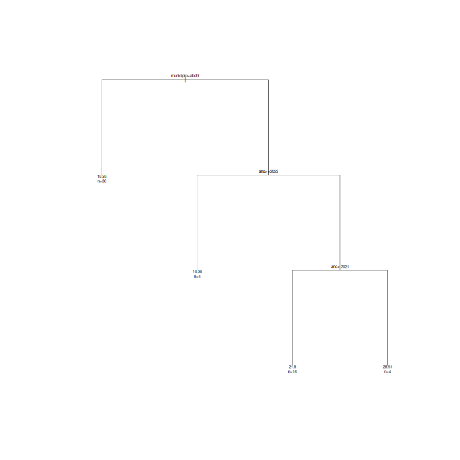
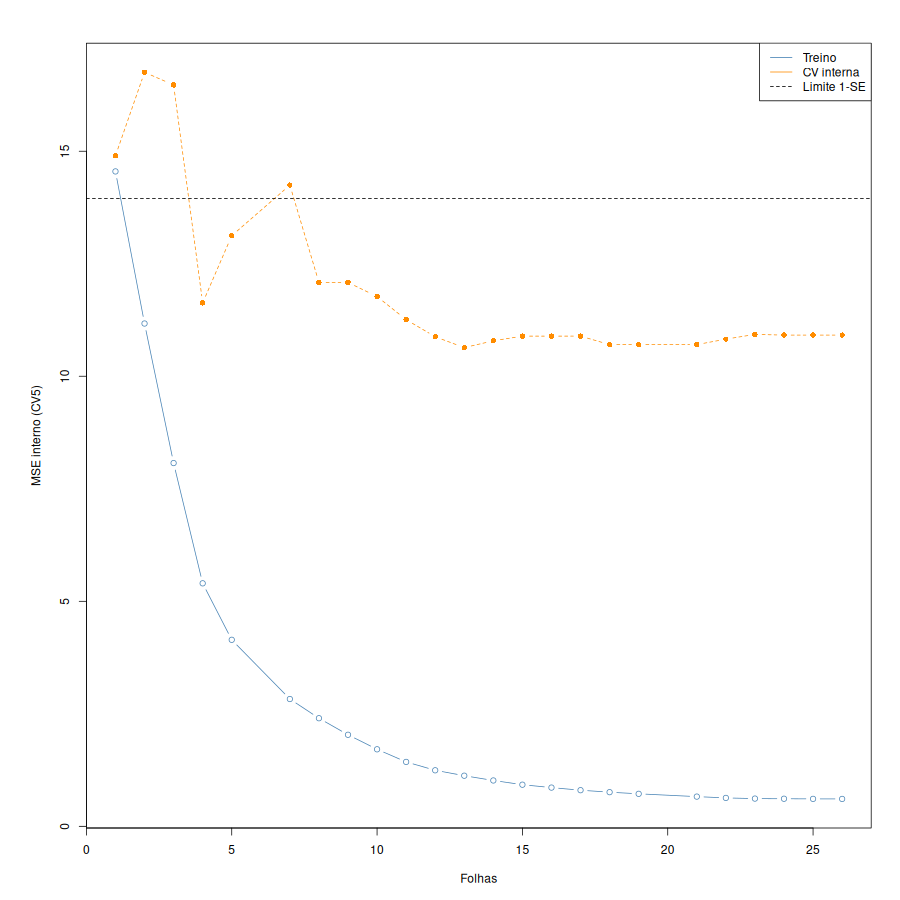
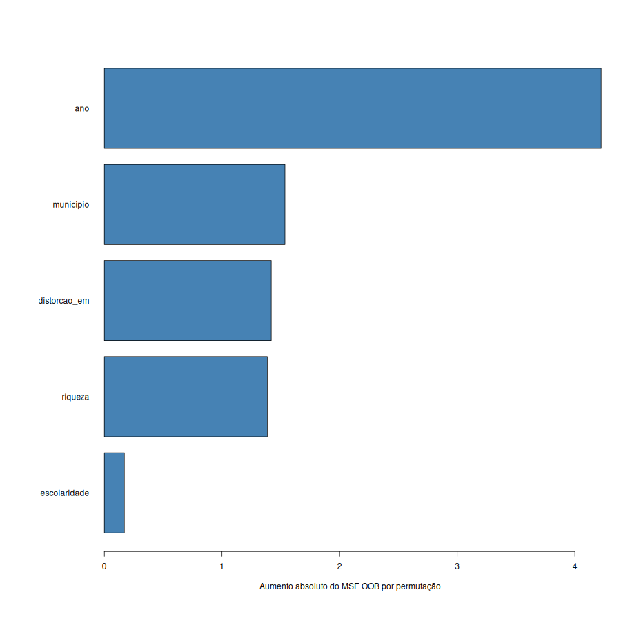
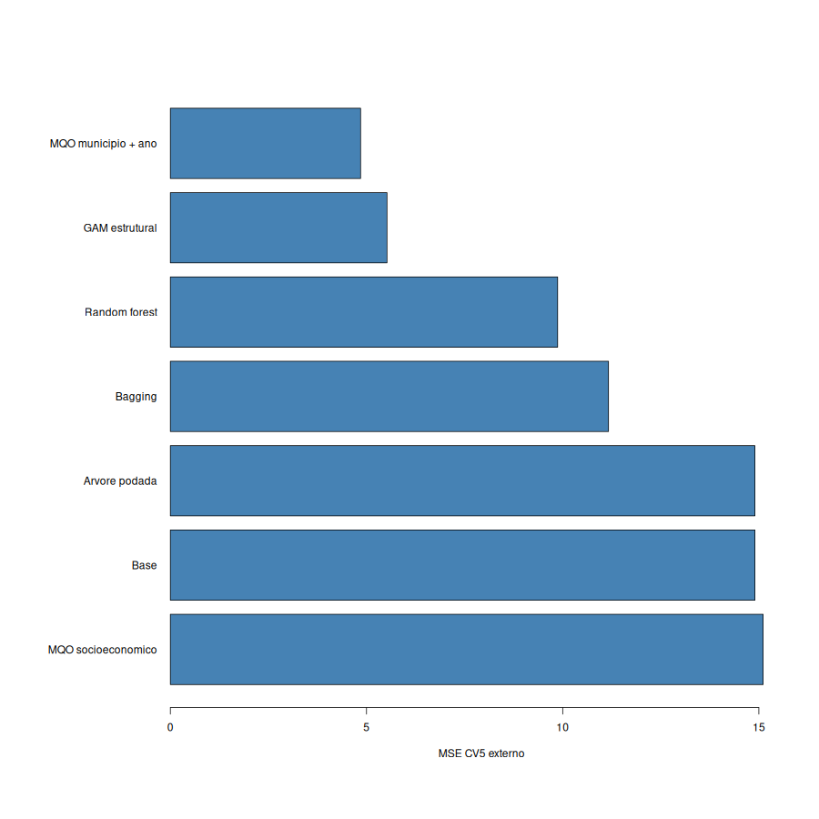

# Atividade 10 — Árvores de Decisão, Bagging e Random Forest (Aula 11)

> **Este documento é o resultado do script**  
> [`estrutura/codigos/10-arvores-florestas.R`](../estrutura/codigos/10-arvores-florestas.R) (auditoria numérica em [`10-numeros.txt`](../estrutura/codigos/10-numeros.txt); predições por observação em [`10-predicoes.csv`](../estrutura/codigos/10-predicoes.csv); placar em [`10-resultados.csv`](../estrutura/codigos/10-resultados.csv)).

> **Alvo ($Y$):** `mortalidade_60_69` (mortes por mil habitantes na faixa 60–69 anos).  
> **Preditores ($p = 5$):** `municipio` (fator com 9 níveis), `ano`, `riqueza`, `escolaridade` e `distorcao_em`. (`ipdm` e `longevidade` foram excluídos por circularidade com a resposta).

---

## 1. Fundamentação Teórica e Matemática (Aula 11)

Na [Atividade 09 (Aula 10)](09-splines-modelos-aditivos.md), o **GAM** somou uma curva suave para cada preditor ($y = \beta_0 + \sum_j f_j(x_j)$), escapando da maldição da dimensionalidade sob a **hipótese de aditividade**. Contudo, se o efeito de uma variável depender do valor de outra (**interação**), um modelo aditivo puro só enxerga esse efeito se o especificarmos manualmente.

As **Árvores de Decisão (CART — *Classification and Regression Trees*)** resolvem isso particionando o espaço dos preditores em caixas retangulares $R_1, \dots, R_J$ por meio de perguntas binárias sequenciais ("sim/não"): como a pergunta do nó filho depende da resposta do nó pai, **a árvore captura interações automaticamente**.

### 1.1. Árvores de Regressão, Divisão Binária Recursiva e Poda por Custo-Complexidade

Em uma árvore de regressão com $J = \lvert T\rvert$ folhas (regiões terminais $R_1, \dots, R_J$), a predição dentro de cada folha $R_m$ é a média das observações de treino que caem nela ($\hat{y}_{R_m} = \frac{1}{\lvert R_m\rvert}\sum_{i : x_i \in R_m} y_i$), escolhida para minimizar a soma dos quadrados dos resíduos:

$$
\mathrm{RSS}(T) = \sum_{m=1}^{\lvert T\rvert} \sum_{i : x_i \in R_m} \left(y_i - \hat{y}_{R_m}\right)^2
$$

Como testar todas as partições possíveis é computacionalmente inviável, o algoritmo cresce por **divisão binária recursiva gulosa**: em cada nó, escolhe o par $(j, s)$ (preditor $j$ e ponto de corte $s$) que mais reduz o $\mathrm{RSS}$ naquele passo imediato. Sem freio, a árvore cresce até decorar o treino; para controlar a variância, aplicamos a **poda por custo-complexidade**, que penaliza o número de folhas $\lvert T\rvert$ com um pedágio $\alpha \ge 0$:

$$
C_\alpha(T) = \sum_{m=1}^{\lvert T\rvert} \sum_{i : x_i \in R_m} \left(y_i - \hat{y}_{R_m}\right)^2 + \alpha \lvert T\rvert
$$

No pacote `rpart` do R, o parâmetro `cp` é adimensional e mede a penalidade como fração do $\mathrm{RSS}$ da árvore raiz (1 folha): $\alpha = \mathrm{cp} \times \mathrm{RSS}_{\mathrm{raiz}}$. Pela **regra de 1 erro-padrão (1-SE)**, escolhemos a menor subárvore cujo erro de validação cruzada interna fica abaixo de $\mathrm{CV}_{\mathrm{min}} + \mathrm{EP}_{\mathrm{min}}$.

### 1.2. Impureza em Árvores de Classificação (Erro, Gini e Entropia)

Quando $Y$ é qualitativa com $K$ classes e $\hat{p}_{mk}$ é a proporção da classe $k$ na folha $m$, o $\mathrm{RSS}$ dá lugar a três medidas de impureza (que valem $0$ numa folha pura e atingem o máximo quando as classes estão empatadas):

$$
E = 1 - \max_k \hat{p}_{mk}, \qquad G = \sum_{k=1}^{K} \hat{p}_{mk}(1 - \hat{p}_{mk}), \qquad D = -\sum_{k=1}^{K} \hat{p}_{mk}\log_2 \hat{p}_{mk}
$$

No caso binário ($K = 2$, com proporção $p$ de "sim"): $E = \min(p, 1-p)$, $G = 2p(1-p)$ e $D = -p\log_2 p - (1-p)\log_2(1-p)$. O Gini e a entropia são estritamente côncavos e diferenciáveis, premiando divisões que deixam um dos nós filhos mais puro mesmo quando o erro de classificação $E$ empata.

### 1.3. Bagging, Floresta Aleatória (`randomForest`) e Erro Fora do Saco (OOB)

Uma única árvore tem **alta variância** (mudar ligeiramente a amostra altera a pergunta da raiz e toda a cascata abaixo). Se tirarmos a média de $B$ árvores ajustadas em amostras *bootstrap*, cada uma com variância $\sigma^2$ e correlação $\rho$ entre pares, a variância da média é:

$$
\mathrm{Var}\left(\frac{1}{B}\sum_{b=1}^{B} \hat{f}_b(x_0)\right) = \rho\sigma^2 + \frac{1 - \rho}{B}\sigma^2
$$

- **Bagging (*Bootstrap Aggregating*, $m = p$):** Faz $B$ grande ($B = 500$), matando o segundo termo $\frac{1-\rho}{B}\sigma^2$. Porém, como o preditor mais forte entra na raiz de quase todas as árvores, a correlação $\rho$ entre elas permanece alta.
- **Floresta Aleatória (*Random Forest*, $m < p$):** Em **cada nó** de cada árvore, sorteia apenas $m$ (`mtry`) dos $p$ preditores candidatos antes de buscar o melhor corte. Isso impede que o preditor dominante monopolize todas as raízes, **reduzindo a correlação $\rho$ entre as árvores** e diminuindo o termo $\rho\sigma^2$.
- **Erro Fora do Saco (*Out-of-Bag*, OOB):** Em uma amostra *bootstrap* de tamanho $n$ com reposição, a probabilidade de uma observação específica ficar de fora é $(1 - 1/n)^n \to e^{-1} \approx 0{,}368$ ($36{,}8\%$). Prever cada observação $i$ usando exclusivamente as árvores que **não** a sortearam fornece uma estimativa de validação interna "de graça" ($\mathrm{MSE}_{\mathrm{OOB}}$).

---

## 2. Protocolo Experimental e Placar no Banco IPDM

Para evitar qualquer otimismo de seleção, aplicamos **validação cruzada aninhada (*nested CV*)** sobre as mesmas 5 dobras externas (`seed = 1`):
- Na **Árvore Podada (`rpart`)**, o parâmetro `cp` é selecionado dentro de cada treino externo por CV interna de 5 dobras usando a **regra de 1 erro-padrão (1-SE)**;
- Na **Random Forest**, o hiperparâmetro `mtry` $\in \lbrace 1, 2, 3, 5 \rbrace$ é selecionado exclusivamente dentro de cada treino externo pelo menor erro OOB;
- O **Bagging** fixa `mtry = 5` ($m = p$) e $500$ árvores;
- A **Linha de Base** usa exclusivamente a média do treino de cada dobra.

| Modelo | MSE_CV5 | RMSE_CV5 | MSE_OOB | Ganho de MSE vs. Base |
| --- | --- | --- | --- | --- |
| **Base** (média do treino) | 14.8991 | 3.8599 | NA | 0,00% |
| **MQO socioeconomico** (`riqueza + escolaridade + distorcao_em`) | 15.1094 | 3.8871 | NA | -1,41% |
| **MQO municipio + ano** (Pergunta 1 — Efeitos Fixos) | **4.8496** | **2.2022** | NA | **+67,45%** |
| **GAM estrutural** (`municipio + s(ano) + s(riqueza)`) | 5.5222 | 2.3499 | NA | +62,94% |
| **Arvore podada** (CART + regra 1-SE em CV interna) | 14.8991 | 3.8599 | NA | 0,00% |
| **Bagging** (`mtry = 5`, $B = 500$) | 11.1677 | 3.3418 | 9.4905 | +25,04% |
| **Random forest** (`mtry` selecionado por OOB interno, $B = 500$) | 9.8713 | 3.1419 | 9.7423 | +33,75% |

- **Ajuste no painel completo ($n = 54$):** `mtry` final selecionado por OOB $= \mathbf{1}$; $\mathrm{MSE}_{\mathrm{OOB}} = \mathbf{9{,}7423}$ (enquanto o Bagging com `mtry = 5` obtém $\mathrm{MSE}_{\mathrm{OOB}} = 9{,}4905$ na base completa, mas perde para a Random Forest na CV5 externa: $11{,}1677$ vs. $9{,}8713$). O erro OOB é um diagnóstico interno ao bootstrap e distinto do erro de validação cruzada externa.

---

## 3. Análise da Árvore CART e da Curva de Poda

Na amostra completa ($n = 54$), a árvore selecionada pela regra 1-SE possui **4 folhas** (3 divisões) e começa perguntando na raiz justamente pelo **`municipio`**:

```
n= 54 

node), split, n, deviance, yval
      * denotes terminal node

 1) root 54 785.755100 19.90563  
   2) municipio=Bertioga,Cubatão,Guarujá,Santos,São Vicente 30 195.120100 18.26136 *
   3) municipio=Itanhaém,Mongaguá,Peruíbe,Praia Grande 24 408.141500 21.96096  
     6) ano>=2023 4   1.030559 16.05529 *
     7) ano< 2023 20 239.701800 23.14209  
      14) ano< 2021 16  64.720710 21.79907 *
      15) ano>=2021 4  30.683710 28.51419 *
```

> **Frase de entrega do laboratório (primeira pergunta e interação):**  
> *"A primeira pergunta da árvore na raiz divide a Baixada Santista em dois blocos territoriais: o **núcleo central/norte** (Bertioga, Cubatão, Guarujá, Santos e São Vicente, que vira folha terminal com média de $18{,}26$ mortes/mil hab.) contra o **Litoral Sul + Praia Grande** (Itanhaém, Mongaguá, Peruíbe e Praia Grande, média de $21{,}96$). Apenas no ramo direito (Litoral Sul + Praia Grande) a árvore faz duas perguntas adicionais sobre o **`ano`**, isolando a queda de 2024 ($\mathrm{ano} \ge 2023 \implies 16{,}06$), o período pré-pico ($\mathrm{ano} < 2021 \implies 21{,}80$) e o pico pandêmico de 2022 ($\mathrm{ano} \in [2021, 2023) \implies \mathbf{28{,}51}$ mortes/mil hab.) — revelando uma **interação condicional empírica** onde o choque pandêmico de 2022 foi ainda mais severo nos municípios do Litoral Sul."*

*(Nota sobre as dobras de treino externas: dentro de cada uma das 5 dobras de treino com $n_{\mathrm{tr}} \approx 43$, a regra conservadora de 1-SE encolhe a árvore até a raiz `cp = 1`, razão pela qual a `Arvore podada` empata exatamente com a `Base` no placar externo $\mathrm{MSE}_{\mathrm{CV5}} = 14{,}8991$).*

### Figura 1 — Árvore Selecionada na Base Completa


### Figura 2 — Curva de Poda por Custo-Complexidade (`cp`)


- O erro de treino (azul) cai monotonicamente conforme aumentamos o número de folhas, enquanto o erro de validação cruzada interna (laranja) atinge o mínimo em 4 folhas e volta a subir quando a árvore fragmenta demais os $n = 54$ registros.

---

## 4. Bagging, Floresta Aleatória e Importância por Permutação

Quando passamos de uma única árvore para a média de $500$ árvores, o erro de validação cruzada externa despenca de $14{,}8991$ para **$11{,}1677$ no Bagging** e **$9{,}8713$ na Random Forest** ($\mathrm{RMSE} = 3{,}1419$).

Medindo a importância dos preditores pelo **aumento absoluto do MSE OOB ao permutar cada coluna** (`type = 1, scale = FALSE`):

| Variavel | Aumento_MSE_OOB | Leitura na Floresta Aleatória |
| --- | --- | --- |
| **`ano`** | **4.2231** | **1º preditor mais importante:** embaralhar o ano destrói a captura do pico pandêmico de 2020–2022 |
| **`municipio`** | **1.5354** | **2º preditor mais importante:** captura o desnível estrutural entre Litoral Sul e Santos |
| **`distorcao_em`** | 1.4189 | 3º lugar: proxy complementar de vulnerabilidade social |
| **`riqueza`** | 1.3853 | 4º lugar: contraste econômico municipal |
| **`escolaridade`** | 0.1700 | Impacto marginal próximo de zero (confirmando as Atividades 03–09) |

### Figura 3 — Importância dos Preditores na Floresta Aleatória (Permutação OOB)


---

## 5. Consequências para a Pergunta de Pesquisa (Entrega 1)

### Figura 4 — Placar Geral de Modelos em CV(5) Externa


1. **Por que o MQO estrutural (`municipio + factor(ano)`, $\mathrm{MSE} = 4{,}85$) e o GAM ($\mathrm{MSE} = 5{,}52$) vencem as árvores e a Random Forest ($\mathrm{MSE} = 9{,}87$)?**  
   Nosso banco é um painel curto ($n = 54$) com um fator de 9 níveis (`municipio`) e 6 anos. Para uma árvore estimar 9 patamares municipais e 6 patamares temporais por cortes retangulares sucessivos, ela rapidamente fica sem observações nas folhas ($\approx 43$ observações no treino divididas em dezenas de células). Já o modelo linear aditivo de efeitos fixos (`lm(y ~ municipio + factor(ano))`) compartilha a informação de todos os municípios para estimar o choque de cada ano e vice-versa, atingindo $\mathrm{RMSE} = 2{,}2022$.
2. **Nossa Pergunta 1 permanece firme:** As árvores e a importância da floresta confirmam que **`ano` e `municipio` são os protagonistas absolutos** da mortalidade de 60 a 69 anos na Baixada Santista, e que o modelo paramétrico/semiparamétrico aditivo de painel continua sendo o campeão indiscutível para $n = 54$.

---

## 6. Resolução Completa dos Exercícios da Aula 11 (Slides 25/28 e 26/28)

Para fundamentação teórica completa do grupo, apresentamos a resolução passo a passo de todos os exercícios dos slides 25/28 e 26/28 da Aula 11 ([`slides_aulas/Aula 11 - Árvores de Decisão e Random Forest.PDF`](../slides_aulas/Aula%2011%20-%20%C3%81rvores%20de%20Decis%C3%A3o%20e%20Random%20Forest.PDF)).

### Parte A: Exercícios de Cálculo (Slide 25/28)

#### Exercício 1: Escolha do Corte na Raiz pelo RSS
*Enunciado:* Áreas $50, 70, 90, 120, 150$ e $200\ \mathrm{m}^2$; preços $200, 220, 260, 300, 310$ e $420$ mil R\$. Calcule o $\mathrm{RSS}$ dos cortes em $80$, $135$ e $175\ \mathrm{m}^2$. Qual a árvore escolhe?

*Resolução:*
1. **Corte em $s = 80\ \mathrm{m}^2$:**
   - Filho esquerdo ($\mathrm{area} < 80$): preços $\lbrace 200, 220 \rbrace \implies$ média $\bar{y}_E = 210 \implies \mathrm{RSS}_E = (200-210)^2 + (220-210)^2 = 100 + 100 = 200$.
   - Filho direito ($\mathrm{area} \ge 80$): preços $\lbrace 260, 300, 310, 420 \rbrace \implies$ média $\bar{y}_D = \frac{1290}{4} = 322{,}5 \implies \mathrm{RSS}_D = (-62{,}5)^2 + (-22{,}5)^2 + (-12{,}5)^2 + (97{,}5)^2 = 3906{,}25 + 506{,}25 + 156{,}25 + 9506{,}25 = 14.075$.
   - **$\mathrm{RSS}(80) = 200 + 14.075 = \mathbf{14.275}$.**
2. **Corte em $s = 135\ \mathrm{m}^2$:**
   - Filho esquerdo ($\mathrm{area} < 135$): preços $\lbrace 200, 220, 260, 300 \rbrace \implies$ média $\bar{y}_E = \frac{980}{4} = 245 \implies \mathrm{RSS}_E = (-45)^2 + (-25)^2 + (15)^2 + (55)^2 = 2025 + 625 + 225 + 3025 = 5.900$.
   - Filho direito ($\mathrm{area} \ge 135$): preços $\lbrace 310, 420 \rbrace \implies$ média $\bar{y}_D = 365 \implies \mathrm{RSS}_D = (-55)^2 + (55)^2 = 3025 + 3025 = 6.050$.
   - **$\mathrm{RSS}(135) = 5.900 + 6.050 = \mathbf{11.950}$.**
3. **Corte em $s = 175\ \mathrm{m}^2$:**
   - Filho esquerdo ($\mathrm{area} < 175$): preços $\lbrace 200, 220, 260, 300, 310 \rbrace \implies$ média $\bar{y}_E = \frac{1290}{5} = 258 \implies \mathrm{RSS}_E = (-58)^2 + (-38)^2 + 2^2 + 42^2 + 52^2 = 3364 + 1444 + 4 + 1764 + 2704 = 9.280$.
   - Filho direito ($\mathrm{area} \ge 175$): preço $\lbrace 420 \rbrace \implies$ média $\bar{y}_D = 420 \implies \mathrm{RSS}_D = 0$.
   - **$\mathrm{RSS}(175) = 9.280 + 0 = \mathbf{9.280}$.**
4. **Decisão da árvore:** A árvore escolhe o corte em **$175\ \mathrm{m}^2$**, pois produz o menor $\mathrm{RSS}$ total ($9.280 < 11.950 < 14.275$).

---

#### Exercício 2: Impurezas (Erro, Gini e Entropia) e Desempate de Divisões
*Enunciado:* Um nó tem $30$ caros e $10$ não: calcule erro, Gini e entropia. Compare as divisões $\mathrm{A} = (20, 0) + (10, 10)$ e $\mathrm{B} = (25, 5) + (5, 5)$ pelo erro e pelo Gini ponderados.

*Resolução:*
1. **No nó pai ($n = 40$, com $p = 30/40 = 0{,}75$ caros e $1 - p = 0{,}25$ não caros):**
   - **Erro de classificação:** $E = \min(0{,}75; 0{,}25) = \mathbf{0{,}250}$.
   - **Índice de Gini:** $G = 2p(1-p) = 2(0{,}75)(0{,}25) = \mathbf{0{,}375}$.
   - **Entropia:** $D = -0{,}75\log_2(0{,}75) - 0{,}25\log_2(0{,}25) \approx 0{,}3113 + 0{,}5000 = \mathbf{0{,}8113}$ **bits**.
2. **Divisão A: Filho 1 com $(20, 0)$ ($n_1 = 20, p_1 = 1{,}0$, puro) e Filho 2 com $(10, 10)$ ($n_2 = 20, p_2 = 0{,}5$):**
   - **Erro ponderado:** $E_{\mathrm{A}} = \frac{20}{40}(0) + \frac{20}{40}(0{,}5) = \mathbf{0{,}250}$ ($10$ erros em $40$).
   - **Gini ponderado:** $G_{\mathrm{A}} = \frac{20}{40}\bigl[2(1)(0)\bigr] + \frac{20}{40}\bigl[2(0{,}5)(0{,}5)\bigr] = 0{,}5(0) + 0{,}5(0{,}5) = \mathbf{0{,}250}$.
3. **Divisão B: Filho 1 com $(25, 5)$ ($n_1 = 30, p_1 = 5/6$) e Filho 2 com $(5, 5)$ ($n_2 = 10, p_2 = 0{,}5$):**
   - **Erro ponderado:** $E_{\mathrm{B}} = \frac{30}{40}\left(\frac{1}{6}\right) + \frac{10}{40}\left(\frac{1}{2}\right) = \frac{5}{40} + \frac{5}{40} = \mathbf{0{,}250}$ ($10$ erros em $40$).
   - **Gini ponderado:** $G_{\mathrm{B}} = \frac{30}{40}\left[2\cdot\frac{5}{6}\cdot\frac{1}{6}\right] + \frac{10}{40}\bigl[2(0{,}5)(0{,}5)\bigr] = \frac{3}{4}\left(\frac{10}{36}\right) + \frac{1}{4}(0{,}5) = \frac{5}{24} + \frac{3}{24} = \frac{8}{24} \approx \mathbf{0{,}3333}$.
4. **Comparação:** Pelo **erro de classificação**, as duas divisões **empatam** em $0{,}250$ (e nem sequer reduzem o erro do nó pai!). Pelo **Gini**, a **Divisão A vence com folga** ($0{,}250 < 0{,}333$), pois isolou uma folha 100% pura de $20$ imóveis caros.

---

#### Exercício 3: Probabilidade Fora do Saco (OOB)
*Enunciado:* Calcule $(1 - 1/n)^n$ para $n = 10$ e $n = 1.000$. Com $300$ árvores e $n = 1.000$, de quantas árvores cada observação fica de fora, em média?

*Resolução:*
- Para $n = 10$: $(1 - 1/10)^{10} = (0{,}9)^{10} \approx \mathbf{0{,}3487}$ ($34{,}87\%$).
- Para $n = 1.000$: $(1 - 1/1000)^{1000} = (0{,}999)^{1000} \approx \mathbf{0{,}3677}$ ($36{,}77\%$, convergindo para $e^{-1} \approx 0{,}3679$).
- Com $B = 300$ árvores e $n = 1.000$, cada observação fica fora do saco (OOB) em média em $300 \times 0{,}3677 \approx \mathbf{110{,}3}$ **árvores** ($\approx 110$ árvores).

---

#### Exercício 4: Poda por Custo-Complexidade $\mathrm{RSS} + \alpha\lvert T\rvert$
*Enunciado:* Subárvores de $1, 4$ e $12$ folhas têm $\mathrm{RSS}$ $900, 300$ e $200$. Qual minimiza $\mathrm{RSS} + \alpha\lvert T\rvert$ com $\alpha = 10, 50$ e $300$? Desde que $\alpha$ a de $4$ vence a de $12$?

*Resolução:*
- Sejam $T_1$ ($\lvert T_1\rvert = 1, \mathrm{RSS}_1 = 900$), $T_4$ ($\lvert T_4\rvert = 4, \mathrm{RSS}_4 = 300$) e $T_{12}$ ($\lvert T_{12}\rvert = 12, \mathrm{RSS}_{12} = 200$):
  - **Com $\alpha = 10$:** $C_{10}(T_1) = 900 + 10 = 910$; $C_{10}(T_4) = 300 + 40 = 340$; $C_{10}(T_{12}) = 200 + 120 = \mathbf{320} \implies$ **vence a de 12 folhas**.
  - **Com $\alpha = 50$:** $C_{50}(T_1) = 900 + 50 = 950$; $C_{50}(T_4) = 300 + 200 = \mathbf{500}$; $C_{50}(T_{12}) = 200 + 600 = 800 \implies$ **vence a de 4 folhas**.
  - **Com $\alpha = 300$:** $C_{300}(T_1) = 900 + 300 = \mathbf{1.200}$; $C_{300}(T_4) = 300 + 1200 = 1.500$; $C_{300}(T_{12}) = 200 + 3600 = 3.800 \implies$ **vence a raiz de 1 folha**.
- **Limiar em que $T_4$ passa a vencer $T_{12}$:** Queremos $300 + 4\alpha \le 200 + 12\alpha \iff 8\alpha \ge 100 \iff \alpha \ge \frac{100}{8} = \mathbf{12{,}5}$. Logo, a partir de **$\alpha = 12{,}5$** (e até $\alpha = 200$, onde empata com $T_1$), a árvore de 4 folhas vence a de 12.

---

### Parte B: Exercícios Conceituais (Slide 26/28)

1. **Guloso (Por que a árvore não testa todas as partições e exemplo onde a 1ª pergunta falha):**  
   O número de maneiras de particionar o espaço em $J$ caixas cresce combinatoriamente com $p$ e $n$, tornando a busca exata intratável; por isso o CART olha apenas um passo à frente. **Exemplo de falha gulosa:** suponha que o preço seja $Y = 100$ quando ($\mathrm{area} \ge 150$ **e** $\mathrm{dist} < 1$) ou quando ($\mathrm{area} < 150$ **e** $\mathrm{dist} \ge 1$), e $Y = 0$ nos outros dois quadrantes (estrutura XOR / tabuleiro de xadrez com contagens iguais). Qualquer primeiro corte marginal em `area = 150` ou `dist = 1` deixa exatamente a mesma média ($50$) dos dois lados ($\Delta\mathrm{RSS} = 0$), parecendo inútil no passo 1 mesmo que os dois cortes juntos zerem o erro no passo 2!
2. **Interação de graça (Árvore vs. GAM):**  
   No GAM ($y = \beta_0 + f_1(x_1) + f_2(x_2)$), o efeito de $x_1$ é somado ao de $x_2$, sendo o mesmo em qualquer nível de $x_2$. Na árvore, cada nó divide apenas o subconjunto que respondeu "sim" ou "não" na pergunta anterior: assim, a pergunta feita no ramo esquerdo pode usar outra variável ou outro ponto de corte do que no ramo direito, modelando interações automaticamente.
3. **Mais árvores $\times$ árvore maior:**  
   Crescer mais folhas numa única árvore reduz o tamanho de cada folha até $1$ observação, fazendo o viés cair e a **variância explodir** (decora o ruído do treino). Já aumentar o número de árvores $B$ no Bagging/Random Forest apenas tira a **média** de mais variáveis aleatórias identicamente distribuídas: pela fórmula $\rho\sigma^2 + \frac{1-\rho}{B}\sigma^2$, quando $B \to \infty$ o segundo termo converge suavemente para zero sem aumentar a complexidade individual de cada árvore.
4. **Sortear preditores (`mtry`):**  
   Sortear $m < p$ candidatos em cada nó impede que o preditor mais forte seja escolhido na raiz de todas as árvores, reduzindo a correlação $\rho$ entre as árvores da floresta. Com apenas $p = 3$ preditores (dos quais um, `idade`, é fraco), reduzir para $m = 1$ força um terço dos cortes a usar o preditor fraco sozinho, piorando demais cada árvore individual em troca de pouca descorrelação; já com dezenas de preditores, o ganho em reduzir $\rho$ domina.
5. **Importância não é causa:**  
   **Não necessariamente.** A importância por permutação mede apenas o quanto a **floresta ajustada depende daquela coluna para prever na amostra observada** (associação preditiva). Ela **não informa o sinal/direção** do efeito (se aumenta ou reduz $Y$) e **não prova causalidade** (imóveis maiores podem estar em bairros mais nobres ou ter melhor acabamento não medido no banco).

---

## Documentos Complementares

- 🧮 **Script gerador:** [`10-arvores-florestas.R`](../estrutura/codigos/10-arvores-florestas.R)
- 📋 **Auditoria numérica:** [`10-numeros.txt`](../estrutura/codigos/10-numeros.txt)
- 📊 **Predições por observação:** [`10-predicoes.csv`](../estrutura/codigos/10-predicoes.csv)
- 📈 **Tabela de resultados:** [`10-resultados.csv`](../estrutura/codigos/10-resultados.csv)
