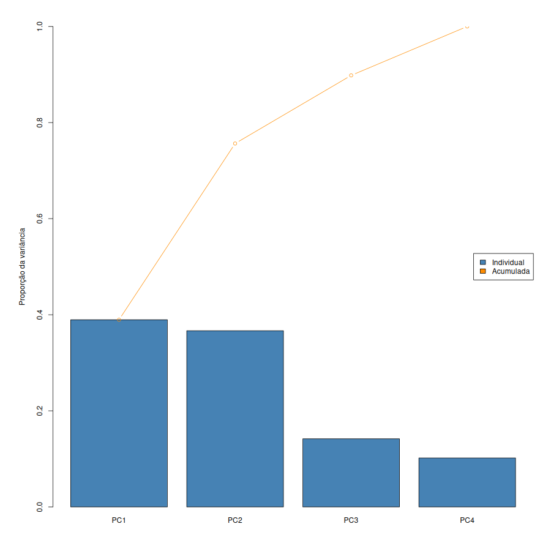
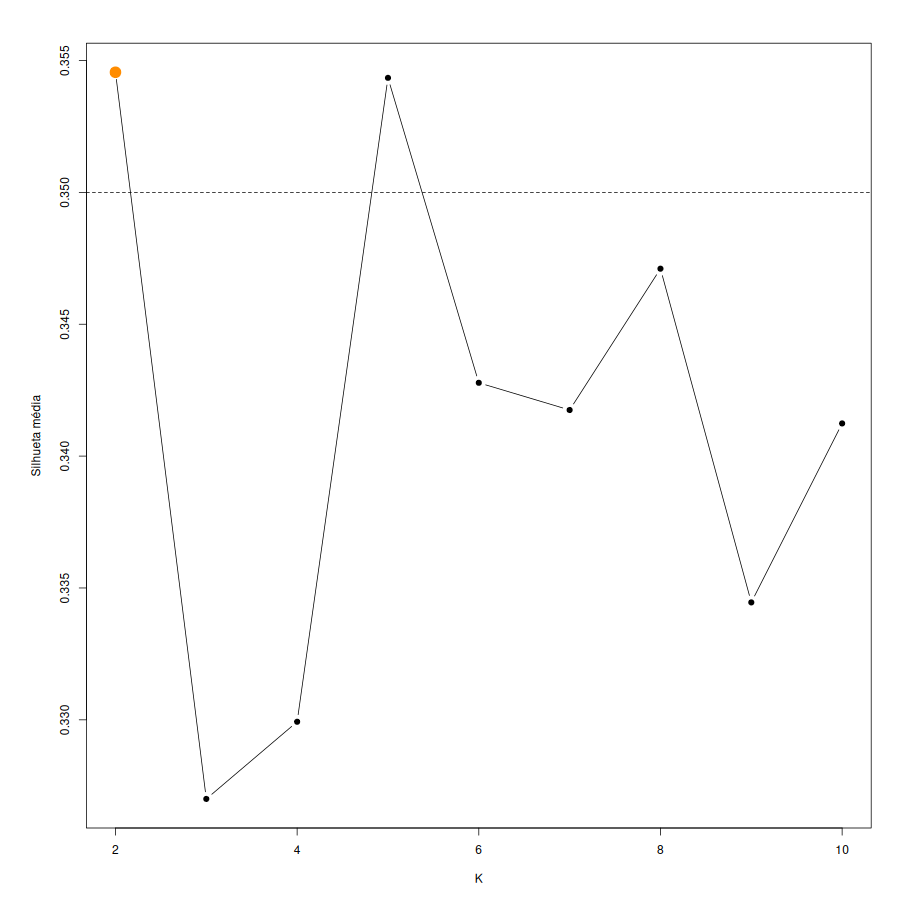
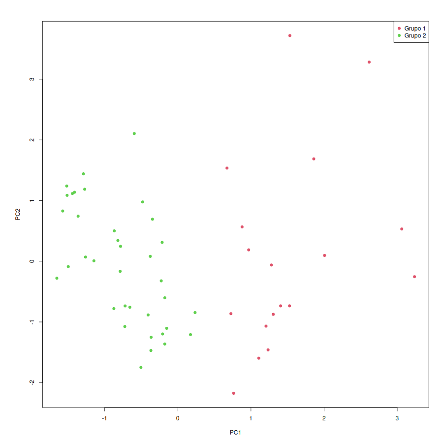
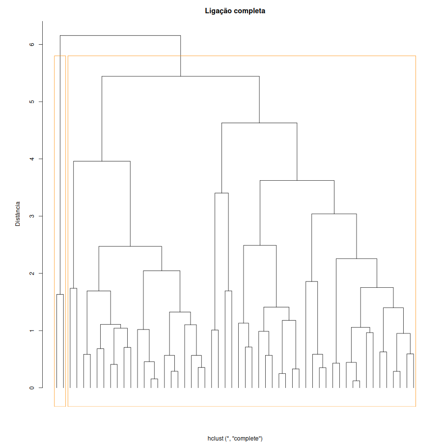
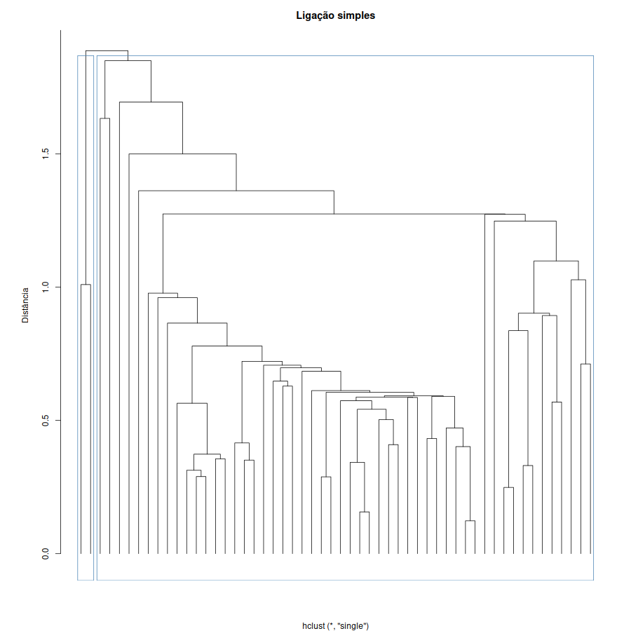

# Atividade 11 — Agrupamento ($K$-Médias e Hierárquico) e Componentes Principais (PCA) — Aula 12

> **Este documento é o resultado do script**  
> [`estrutura/codigos/11-agrupamento-pca.R`](../estrutura/codigos/11-agrupamento-pca.R) (auditoria numérica em [`11-numeros.txt`](../estrutura/codigos/11-numeros.txt); grupos e escores por município-ano em [`11-grupos.csv`](../estrutura/codigos/11-grupos.csv)).

> **Matriz de atributos não-supervisionada ($\mathbf{X}$, $p = 4$):** `riqueza`, `escolaridade`, `distorcao_em` e `pib_per_capita`.  
> **Variáveis excluídas de $\mathbf{X}$:** `mortalidade_60_69` ($Y$, guardada fora da análise e consultada apenas ao final para diagnóstico externo), `longevidade` e `ipdm` (compostos que incorporam $Y$), além dos identificadores `municipio` e `ano`.

---

## 1. Fundamentação Teórica e Matemática (Aula 12)

Nas Aulas 04 a 11 (aprendizado supervisionado), todos os modelos tinham uma variável resposta $Y$ e eram avaliados pelo erro fora da amostra. Na **Aula 12**, entramos no **aprendizado não-supervisionado**: dispomos apenas da matriz de características $\mathbf{X} \in \mathbb{R}^{n \times p}$ e buscamos descobrir estrutura interna nos dados por duas vias complementares:
1. **Agrupamento (*Clustering* — $K$-médias e Hierárquico):** encontrar grupos de observações parecidas entre si (linhas de $\mathbf{X}$);
2. **Análise de Componentes Principais (PCA):** encontrar poucas combinações lineares ortogonais que resumam a maior parte da variância das colunas de $\mathbf{X}$.

### 1.1. Distância Euclidiana e Obrigatoriedade da Padronização ($z$-score)

Tanto o agrupamento quanto a PCA dependem de distâncias e variâncias. Para evitar que uma variável de escala numérica grande (como `pib_per_capita` em milhares de reais, variando de $20.064$ a $270.119$) domine completamente variáveis em $[0, 1]$ (`riqueza`, `escolaridade`), padronizamos cada coluna $j$ para média $0$ e desvio-padrão $1$:

$$
z_{ij} = \frac{x_{ij} - \bar{x}_j}{s_j}, \qquad d(\mathbf{z}_i, \mathbf{z}_{i'}) = \sqrt{\sum_{j=1}^{p} (z_{ij} - z_{i'j})^2}
$$

### 1.2. Agrupamento por $K$-Médias (*$K$-Means*) e Coeficiente de Silhueta

Uma partição em $K$ grupos disjuntos $C_1, \dots, C_K$ busca minimizar a **soma dos quadrados dentro dos grupos** (*within-cluster sum of squares*, $W$):

$$
W = \sum_{k=1}^{K} \sum_{i \in C_k} \lVert \mathbf{z}_i - \bar{\mathbf{z}}_k \rVert^2, \qquad \bar{\mathbf{z}}_k = \frac{1}{\lvert C_k\rvert}\sum_{i \in C_k} \mathbf{z}_i
$$

- **Algoritmo de Lloyd e ótimos locais:** O algoritmo alterna entre atribuir cada ponto ao centro $\bar{\mathbf{z}}_k$ mais próximo e recalcular os centros como a média de cada grupo. Como ambos os passos nunca aumentam $W$, o algoritmo converge, mas pode parar em um **ótimo local** ruim dependendo do sorteio inicial; por isso usamos `nstart = 50` começos aleatórios e retemos a solução de menor $W$.
- **Escolha de $K$ pela Silhueta:** Como $W$ cai monotonicamente até zero quando $K \to n$, avaliamos a qualidade geométrica de cada $K \ge 2$ pela **silhueta** de cada observação $i \in C$:

$$
s(i) = \frac{b(i) - a(i)}{\max\lbrace a(i), b(i) \rbrace} \in [-1, 1]
$$

onde $a(i)$ é a distância média de $i$ aos demais pontos do seu próprio grupo e $b(i)$ é a menor distância média de $i$ aos pontos de qualquer outro grupo (o "grupo vizinho"). Valores de $s(i)$ próximos de $+1$ indicam alocação coesa e bem separada; próximos de $0$ indicam ponto de fronteira; negativos indicam que $i$ estaria mais perto do grupo vizinho.

### 1.3. Agrupamento Hierárquico Aglomerativo e Critérios de Ligação (*Linkage*)

Em vez de fixar $K$ a priori e depender de sorteios, o agrupamento hierárquico começa com $n$ grupos unitários e funde, a cada passo, o par de grupos $(G, H)$ mais próximo segundo uma função de **ligação**:

$$
d_{\mathrm{completa}}(G, H) = \max_{i \in G,\, j \in H} d(i, j), \qquad d_{\mathrm{simples}}(G, H) = \min_{i \in G,\, j \in H} d(i, j), \qquad d_{\mathrm{media}}(G, H) = \frac{1}{\lvert G\rvert\lvert H\rvert}\sum_{i \in G}\sum_{j \in H} d(i, j)
$$

A **ligação completa** exige que *todos* os pontos dos dois grupos estejam próximos, gerando grupos compactos; já a **ligação simples** une grupos assim que *um único par* está próximo, sofrendo frequentemente do efeito de **encadeamento** (*chaining*).

### 1.4. Análise de Componentes Principais (PCA)

A primeira componente principal $\mathrm{PC}_1 = \phi_{11} z_1 + \dots + \phi_{p1} z_p$ é a combinação linear de pesos unitários ($\sum_{j=1}^p \phi_{j1}^2 = 1$) que maximiza a variância amostral; a segunda, $\mathrm{PC}_2$, maximiza a variância entre todas as combinações descorrelacionadas (ortogonais) com a $\mathrm{PC}_1$, e assim sucessivamente. Algebricamente, os vetores de pesos $\boldsymbol{\phi}_m$ (*loadings*) são os **autovetores** da matriz de correlação $\mathbf{R} = \frac{1}{n-1}\mathbf{Z}^\top\mathbf{Z}$, e as variâncias das componentes são os respectivos **autovalores** $\lambda_1 \ge \lambda_2 \ge \dots \ge \lambda_p \ge 0$ (com $\sum_{m=1}^p \lambda_m = p$). A fração da variância total explicada pela componente $m$ é $\lambda_m / p$.

---

## 2. PCA no Banco IPDM: Interpretação dos Eixos Socioeconômicos

Aplicando a PCA às $p = 4$ colunas padronizadas (`riqueza`, `escolaridade`, `distorcao_em`, `pib_per_capita`) nas $n = 54$ observações:

### 2.1. Variância Explicada por Componente

| PC | Individual | Acumulada | Autovalor ($\lambda_m = 4 \times \mathrm{Individual}$) | Regra Prática ($\lambda_m > 1$ e $\ge 75\%$) |
| --- | --- | --- | --- | --- |
| **PC1** | **0.3896** (38,96%) | 0.3896 (38,96%) | $\lambda_1 = 1{,}558$ | **Retida** ($\lambda_1 > 1$) |
| **PC2** | **0.3668** (36,68%) | **0.7564** (**75,64%**) | $\lambda_2 = 1{,}467$ | **Retida** ($\lambda_2 > 1$, acumula 75,6%) |
| **PC3** | 0.1418 (14,18%) | 0.8981 (89,81%) | $\lambda_3 = 0{,}567$ | Descartada ($\lambda_3 < 1$) |
| **PC4** | 0.1019 (10,19%) | 1.0000 (100,00%) | $\lambda_4 = 0{,}408$ | Descartada ($\lambda_4 < 1$) |

As duas primeiras componentes principais guardam juntas **75,64% de toda a variação** dos quatro indicadores socioeconômicos, resumindo quatro colunas em duas réguas ortogonais:

### 2.2. Pesos (*Loadings*) e Nomeação Substantiva dos Eixos

| Variavel | PC1 | PC2 | Papel na Redução de Dimensionalidade |
| --- | --- | --- | --- |
| `riqueza` | **+0.6895** | +0.0711 | Domina a **PC1** |
| `escolaridade` | +0.2891 | **-0.6380** | Domina a **PC2** (polo negativo) |
| `distorcao_em` | -0.0575 | **+0.7187** | Domina a **PC2** (polo positivo) |
| `pib_per_capita` | **+0.6616** | +0.2672 | Domina a **PC1** |

- **Nome da PC1 — *Intensidade Econômica Municipal* (`riqueza` $+$ / `pib_per_capita` $+$):** Combina com pesos quase iguais e positivos o índice de riqueza ($+0{,}69$) e o PIB per capita ($+0{,}66$). Municípios-ano com escore alto na PC1 (Cubatão, Santos, Bertioga) têm alta atividade econômica e renda; escores baixos indicam o Litoral Sul e São Vicente.
- **Nome da PC2 — *Vulnerabilidade Educacional: Distorção vs. Escolaridade* (`distorcao_em` $+$ / `escolaridade` $-$):** Opõe a taxa de atraso idade-série no Ensino Médio ($+0{,}72$) ao índice de escolaridade ($-0{,}64$). Escores positivos altos na PC2 identificam municípios-ano onde o fluxo escolar é crítico e a escolaridade é baixa (ou onde há forte contraste industrial, como Cubatão nos primeiros biênios); escores muito negativos indicam alta escolaridade e baixa distorção (Santos e edições recentes de 2022–2024).

### Figura 1 — Proporção da Variância Explicada (Scree Plot)

---

## 3. Diagnóstico dos Grupos ($K$-Médias e Silhueta)

Avaliando a silhueta média para $K \in \lbrace 2, \dots, 10 \rbrace$ com 50 inicializações aleatórias (`set.seed(1)`):

| K | Silhueta | Leitura |
| --- | --- | --- |
| **2** | **0.3546** | **Máximo global da silhueta** |
| 3 | 0.3270 | Queda na separação média |
| 4 | 0.3299 | — |
| 5 | 0.3543 | Segundo pico local (subdivisão por município/biênio) |
| 6 | 0.3428 | — |
| 7 | 0.3417 | — |
| 8 | 0.3471 | — |
| 9 | 0.3345 | — |
| 10 | 0.3412 | — |

- **$K$ selecionado:** **$K = 2$** (silhueta média $= \mathbf{0{,}3546}$). A silhueta ligeiramente acima de $0{,}35$ indica uma separação geométrica moderada nesta amostra, dividindo os 54 municípios-ano em dois grandes perfis socioeconômicos:

### Centros dos Grupos nas Unidades Originais e Nomeação dos Perfis

| Grupo | Tamanhos ($N$) | `riqueza` | `escolaridade` | `distorcao_em` (%) | `pib_per_capita` (R\$) | Nome Substantivo do Perfil |
| --- | --- | --- | --- | --- | --- | --- |
| **Grupo 1** | 18 | **0.5195** | **0.5014** | 15.9711 | **112.233,34** | **Polo Econômico-Industrial e Central** (riqueza e PIB per capita elevados: Cubatão, Santos, Bertioga) |
| **Grupo 2** | 36 | **0.3890** | **0.4799** | 16.5746 | **32.753,01** | **Municípios Residenciais de Menor Renda** (riqueza e PIB per capita abaixo da média: Litoral Sul, São Vicente, Praia Grande, Guarujá) |

### Figura 2 — Curva da Silhueta Média por Número de Grupos ($K$)

### Figura 3 — Os Dois Grupos do $K$-Médias Projetados no Plano $\mathrm{PC}_1 \times \mathrm{PC}_2$

- O gráfico no plano das duas primeiras componentes principais mostra claramente que o $K$-médias ($K = 2$) cortou o plano ao longo do eixo horizontal ($\mathrm{PC}_1$ — *Intensidade Econômica*): o **Grupo 1 (vermelho, à direita)** reúne as 18 observações de alta riqueza/PIB, enquanto o **Grupo 2 (verde, à esquerda)** agrupa as 36 observações de menor dinamismo econômico.

---

## 4. Comparação com Agrupamento Hierárquico (Ligação Completa vs. Simples)

Cortando os dendrogramas de ligação completa e simples em $K = 2$ grupos e cruzando com o $K$-médias:

- **Tamanhos dos grupos:** $K$-médias $= (18, 36)$; Ligação completa $= (52, 2)$; Ligação simples $= (52, 2)$.

| Grupo_Kmeans | Hierárquico (Grupo 1) | Hierárquico (Grupo 2) |
| --- | --- | --- |
| **1 (Alta Renda, $N=18$)** | 16 | **2** |
| **2 (Menor Renda, $N=36$)** | 36 | **0** |

**Por que os cortes hierárquicos em $K = 2$ isolaram apenas 2 observações ($52 \times 2$)?**  
Porque as duas edições de **Cubatão com PIB per capita extremo** (acima de R\$ 250 mil) ficam a uma distância euclidiana padronizada enorme de todos os demais municípios-ano. Assim, no topo do dendrograma ($K = 2$), tanto a ligação completa quanto a simples separam primeiro esse par extremo de Cubatão das outras 52 observações, enquanto o $K$-médias (que minimiza a soma quadrática global com centros móveis) produz uma divisão muito mais equilibrada ($18 \times 36$).

### Figura 4 — Dendrograma com Ligação Completa

### Figura 5 — Dendrograma com Ligação Simples

---

## 5. Relação com a Pergunta Supervisionada (Entrega 1)

Consultando a variável resposta $Y$ (`mortalidade_60_69`) **após** a definição cega dos dois grupos pelo $K$-médias:

| Grupo | Perfil Socioeconômico | N | Media ($Y$) | DP ($Y$) | Min ($Y$) | Max ($Y$) |
| --- | --- | --- | --- | --- | --- | --- |
| **1** | Alta Riqueza / PIB per capita | 18 | **17.6586** | 3.0115 | 13.9425 | 25.4285 |
| **2** | Menor Riqueza / PIB per capita | 36 | **21.0291** | 3.7617 | 15.2926 | 32.9968 |

> **O que isso muda para a nossa pergunta da Entrega 1?**  
> 1. **A resposta muda de um grupo para outro?** Sim, de forma descritiva: o Grupo 2 (municípios-ano de menor riqueza e menor PIB per capita) apresenta mortalidade média de **$21{,}03$ mortes/mil hab.**, contra **$17{,}66$ mortes/mil hab.** no Grupo 1 — uma diferença de **$3{,}37$ mortes por mil habitantes** (quase um desvio-padrão global da resposta, $\mathrm{sd}(Y) = 3{,}85$).  
> 2. **O grupo vira preditor ou muda nossa Pergunta 1?** **Não substitui a Pergunta 1.** Os dois grupos capturam essencialmente o contraste socioeconômico estrutural entre o bloco central/industrial e o bloco residencial/Litoral Sul, mas não separam o choque pandêmico de 2020–2022 (tanto que o máximo no Grupo 1 chega a $25{,}43$ e no Grupo 2 a $33{,}00$). Além disso, para usar o cluster ou a $\mathrm{PC}_1$/$\mathrm{PC}_2$ como preditores em um modelo supervisionado sem vazamento de dados, a padronização `scale()`, os autovetores da PCA e os centros do `kmeans()` devem ser recalculados **exclusivamente dentro de cada dobra de treino**. Portanto, a **Pergunta 1 (`municipio + factor(ano)`) permanece como a formulação campeã e definitiva do projeto**.

---

## 6. Resolução Completa dos Exercícios da Aula 12 (Slides 26/29 e 27/29)

Para fundamentação teórica completa do grupo, resolvemos passo a passo todos os exercícios dos slides 26/29 e 27/29 da Aula 12 ([`slides_aulas/Aula 12 - Agrupamento e Componentes Principais.PDF`](../slides_aulas/Aula%2012%20-%20Agrupamento%20e%20Componentes%20Principais.PDF)).

### Parte A: Exercícios de Cálculo (Slide 26/29)

#### Exercício 1: Algoritmo $K$-Médias na Mão com $K = 2$
*Enunciado:* Áreas $50, 60, 70, 140, 150, 160$ e $250\ \mathrm{m}^2$. Rode o $K$-médias com $K = 2$ a partir dos centros $50$ e $60$ até parar. Qual o $W$ final? Compare com o de $K = 3$ e diga por que $W$ sozinho não escolhe $K$.

*Resolução:*
1. **Passo 1 (Centros iniciais $c_1^{(0)} = 50$ e $c_2^{(0)} = 60$; ponto médio $= 55$):**
   - Grupo 1 ($x < 55$): $\lbrace 50 \rbrace \implies$ novo centro $c_1^{(1)} = 50$.
   - Grupo 2 ($x > 55$): $\lbrace 60, 70, 140, 150, 160, 250 \rbrace \implies$ novo centro $c_2^{(1)} = \frac{60+70+140+150+160+250}{6} = \frac{830}{6} \approx 138{,}33$.
2. **Passo 2 (Centros $50$ e $138{,}33$; ponto médio $= 94{,}17$):**
   - O $60$ e o $70$ mudam para o Grupo 1!
   - Grupo 1: $\lbrace 50, 60, 70 \rbrace \implies$ novo centro $c_1^{(2)} = 60$.
   - Grupo 2: $\lbrace 140, 150, 160, 250 \rbrace \implies$ novo centro $c_2^{(2)} = \frac{140+150+160+250}{4} = \frac{700}{4} = 175$.
3. **Passo 3 (Centros $60$ e $175$; ponto médio $= 117{,}5$):**
   - Nenhum ponto muda de lado ($\lbrace 50, 60, 70 \rbrace < 117{,}5 < \lbrace 140, 150, 160, 250 \rbrace$) $\implies$ **o algoritmo para!**
4. **Cálculo de $W$ final para $K = 2$:**
   - $W_1 = (50-60)^2 + (60-60)^2 + (70-60)^2 = 100 + 0 + 100 = 200$.
   - $W_2 = (140-175)^2 + (150-175)^2 + (160-175)^2 + (250-175)^2 = (-35)^2 + (-25)^2 + (-15)^2 + (75)^2 = 1225 + 625 + 225 + 5625 = 7.700$.
   - **$W_{\mathrm{final}}(K=2) = 200 + 7.700 = \mathbf{7.900}$.**
5. **Comparação com $K = 3$ ($W = 400$ no slide 8):** Com $K = 3$, o ponto extremo $250$ ganha um grupo próprio e $W$ despenca de $7.900$ para $400$. Contudo, **$W$ sozinho nunca pode escolher $K$** porque $W$ diminui monotonicamente sempre que adicionamos mais grupos (chegando a $W = 0$ quando $K = n$, onde cada ponto é seu próprio centro).

---

#### Exercício 2: Cálculo da Silhueta do Ponto 160
*Enunciado:* Com os grupos $C_1 = \lbrace 50, 60, 70 \rbrace$, $C_2 = \lbrace 140, 150, 160 \rbrace$ e $C_3 = \lbrace 250 \rbrace$, calcule a silhueta do $160$. Que grupo é o vizinho dele?

*Resolução:*
1. **Distância média interna $a(160)$ (dentro de $C_2 = \lbrace 140, 150, 160 \rbrace$):**
   - Distâncias de $160$ aos outros membros de $C_2$: $\lvert 160 - 140\rvert = 20$ e $\lvert 160 - 150\rvert = 10$.
   - $a(160) = \frac{20 + 10}{2} = \mathbf{15}$.
2. **Distância média aos outros grupos ($C_1$ e $C_3$) e grupo vizinho:**
   - Até $C_1 = \lbrace 50, 60, 70 \rbrace$: média $= \frac{(160-50) + (160-60) + (160-70)}{3} = \frac{110 + 100 + 90}{3} = \mathbf{100}$.
   - Até $C_3 = \lbrace 250 \rbrace$: distância $= \lvert 250 - 160\rvert = \mathbf{90}$.
   - Como $90 < 100$, o **grupo vizinho do 160 é o $C_3 = \lbrace 250 \rbrace$**, logo $b(160) = \min(100, 90) = \mathbf{90}$.
3. **Silhueta de 160:**
   - $s(160) = \frac{b(160) - a(160)}{\max\lbrace a(160), b(160) \rbrace} = \frac{90 - 15}{90} = \frac{75}{90} = \frac{5}{6} \approx \mathbf{0{,}8333}$ (muito bem alocado no grupo do meio).

---

#### Exercício 3: Agrupamento Hierárquico com Ligação Simples e Média
*Enunciado:* Áreas $50, 60, 80, 140$ e $150$: refaça as junções com a ligação simples e com a média. Em que altura o $80$ entra? E a última junção?

*Resolução:*
1. **Primeira junção (igual em ambas):** As menores distâncias entre pares são $d(50, 60) = 10$ e $d(140, 150) = 10$. Ambos os pares se fundem na **altura $10$**, formando $G_1 = \lbrace 50, 60 \rbrace$ e $G_2 = \lbrace 140, 150 \rbrace$.
2. **Entrada do $80$ (juntando-se a $G_1 = \lbrace 50, 60 \rbrace$, formando $G_1' = \lbrace 50, 60, 80 \rbrace$):**
   - As distâncias de $80$ aos membros de $G_1$ são $d(80, 50) = 30$ e $d(80, 60) = 20$.
   - Na **ligação simples** ($\min$): o $80$ entra na **altura $\min(30, 20) = \mathbf{20}$**.
   - Na **ligação média** (média): o $80$ entra na **altura $\frac{30 + 20}{2} = \mathbf{25}$** (lembrando que na completa entrava em $\max(30, 20) = 30$).
3. **Última junção (entre $G_1' = \lbrace 50, 60, 80 \rbrace$ e $G_2 = \lbrace 140, 150 \rbrace$):**
   - As 6 distâncias entre pares de $G_1' \times G_2$ são: $(140-80)=60$, $(150-80)=70$, $(140-60)=80$, $(150-60)=90$, $(140-50)=90$, $(150-50)=100$.
   - Na **ligação simples** ($\min$): a última junção ocorre na **altura $\min = 140 - 80 = \mathbf{60}$**.
   - Na **ligação média** (média das 6 distâncias, ou distância entre os centros $63{,}33$ e $145$): ocorre na **altura $\frac{60+70+80+90+90+100}{6} = \frac{490}{6} \approx \mathbf{81{,}67}$** (na completa ocorria em $\max = 100$).

---

#### Exercício 4: PCA de Duas Colunas Padronizadas ($r = 0{,}6$)
*Enunciado:* Duas colunas padronizadas têm correlação $0{,}6$. Quanto da variância a $\mathrm{PC}_1$ guarda? Escreva a $\mathrm{PC}_1$ e calcule o escore de uma observação com $z = (2, 1)$.

*Resolução:*
1. **Autovalores e fração da variância:** Com $p = 2$ colunas padronizadas e $r = 0{,}6 > 0$, os autovalores da matriz de correlação $\begin{pmatrix} 1 & 0{,}6 \\ 0{,}6 & 1 \end{pmatrix}$ são $\lambda_1 = 1 + r = \mathbf{1{,}6}$ e $\lambda_2 = 1 - r = 0{,}4$.
   - Fração da variância guardada pela $\mathrm{PC}_1$: $\frac{\lambda_1}{2} = \frac{1 + 0{,}6}{2} = \frac{1{,}6}{2} = \mathbf{0{,}80}$ (**$80\%$ da variância total**).
2. **Equação da $\mathrm{PC}_1$:**
   - $\mathrm{PC}_1 = \frac{1}{\sqrt{2}} z_1 + \frac{1}{\sqrt{2}} z_2 = \frac{z_1 + z_2}{\sqrt{2}} \approx 0{,}7071 z_1 + 0{,}7071 z_2$.
3. **Escore da observação com $\mathbf{z} = (2, 1)$:**
   - $\mathrm{PC}_1(2, 1) = \frac{2 + 1}{\sqrt{2}} = \frac{3}{\sqrt{2}} \approx \mathbf{2{,}1213}$.

---

### Parte B: Exercícios Conceituais (Slide 27/29)

1. **Escala (Sem padronizar, quem manda no $K$-médias?):**  
   Sem padronizar, manda a coluna de **maior variância numérica bruta**: no cadastro de imóveis da aula, a **`area`** (em $\mathrm{m}^2$, com desvio-padrão de $41\ \mathrm{m}^2$ e variância de $1.679\ \mathrm{m}^4$, contra $1{,}62\ \mathrm{km}$ da distância). Porém, se a distância até a praia fosse convertida de quilômetros para **metros** ($\times 1.000$), seu desvio-padrão passaria a ser $1.620\ \mathrm{m}$ (variância $> 2{,}6 \times 10^6\ \mathrm{m}^2$) e a **distância em metros passaria a dominar sozinha** todo o agrupamento e a PCA!
2. **Grupos que não existem:**  
   O $K$-médias sempre particiona qualquer nuvem de pontos em $K$ pedaços geométricos, mesmo numa distribuição uniforme sem grupos reais. Para verificar se os grupos realmente existem, devemos: (i) inspecionar a **curva de silhueta** (se ficar baixa, em torno de $0{,}25$–$0{,}30$ e plana sem pico claro, não há separação natural); (ii) testar a **estabilidade** entre múltiplos sorteios e métodos distintos ($K$-médias vs. hierárquico); e (iii) avaliar a **coerência substantiva** dos centros com especialistas do domínio.
3. **Simples $\times$ completa (O efeito de encadeamento):**  
   A ligação simples define a distância entre dois grupos pelo **par único mais próximo**. Se houver alguns imóveis intermediários formando uma "ponte" entre o centro e o bairro afastado, basta uma pequena distância de vizinho a vizinho para a ligação simples fundir os dois grupos inteiros numa corrente (*encadeamento*), deixando um único ponto isolado como terceiro grupo. A ligação completa evita isso porque exige que até os **dois pontos mais distantes** entre os grupos estejam próximos antes de fundi-los.
4. **A $\mathrm{PC}_1$ e o preço (O que a PCA não olha?):**  
   **Não necessariamente.** A PCA é **100% não-supervisionada**: ela escolhe a direção que maximiza a variância interna de $\mathbf{X}$, **sem jamais olhar para a resposta $Y$ (preço)**. Se o preço depender justamente de um contraste sutil capturado pela $\mathrm{PC}_3$ ou por uma única variável que varia pouco, a $\mathrm{PC}_1$ pode explicar $61\%$ de $\mathbf{X}$ e ter correlação fraca com $Y$.
5. **Duas maneiras de usar um agrupamento numa pergunta supervisionada:**  
   - *(i) Como preditor categórico (engenharia de atributos):* transformar o grupo atribuído em variáveis *dummy* (ou incluir os escores das primeiras componentes principais) num modelo supervisionado — **desde que os centros/autovetores sejam estimados exclusivamente dentro de cada dobra de treino na validação cruzada**;  
   - *(ii) Como estratificação/segmentação do problema:* ajustar modelos supervisionados separados por perfil de grupo (ou avaliar se os resíduos do modelo principal se concentram num grupo específico de municípios).

---

## Documentos Complementares

- 🧮 **Script gerador:** [`11-agrupamento-pca.R`](../estrutura/codigos/11-agrupamento-pca.R)
- 📋 **Auditoria numérica:** [`11-numeros.txt`](../estrutura/codigos/11-numeros.txt)
- 📊 **Atribuições de grupos e escores PCA:** [`11-grupos.csv`](../estrutura/codigos/11-grupos.csv)
- 📄 **Artigo da Entrega 1 (PDF):** [`../entregas/entrega-1/entrega-1-pergunta.pdf`](../entregas/entrega-1/entrega-1-pergunta.pdf)
